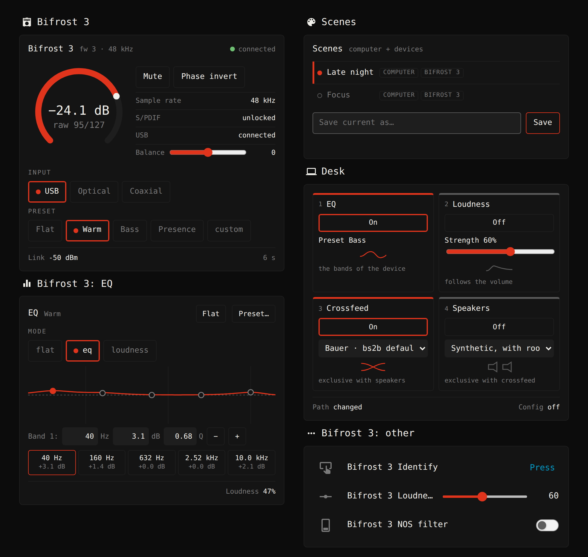
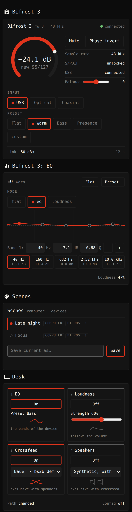

# svolder in Home Assistant

`svolderd` publishes every device it holds to an MQTT broker, announced through Home
Assistant's MQTT discovery: each device appears as a Home Assistant device with an entity per
control, and no YAML is needed for that. This folder adds a dashboard to paste, a theme in
svolder's own colours, and notes from running it against Home Assistant 2026.9 and 2026.10.
`dashboard.yaml` uses the cards Home Assistant ships with: nothing to install from HACS. The
`custom:svolder` strategy (section 5) draws its pages with svolder's own cards, which come in the
same resource file.

 

## 1. A broker Home Assistant uses

- In Home Assistant, install the **Mosquitto broker** add-on (Settings → Add-ons), start it,
  and accept the **MQTT** integration it offers (Settings → Devices & services).
- Give svolder a login. The add-on accepts Home Assistant's own users, so add a person named
  `svolder` with "Allow login" on and a password (Settings → People). Restart the add-on if the
  first connect is refused as not authorised.

## 2. svolder's side

In `~/.config/svolder/config.toml` (or from the TUI's Settings box, Connect category, for
everything but the password):

```toml
[mqtt]
enabled = true
host = "192.0.2.10"        # Home Assistant's address
username = "svolder"
password = "…"             # or SVOLDER_MQTT_PASSWORD in the daemon's environment
commands = true            # off by default: Home Assistant then only reads
max_volume_db = -10.0      # optional: no volume command goes above it
```

The file then holds a password: keep it readable by you alone (`chmod 600`). Restart the
daemon with `svolder daemon restart`. Then `svolder daemon status` says
`mqtt: connected to 192.0.2.10:1883 (commands on)`.

## 3. What appears

Each configured device appears under the MQTT integration with its configured name,
`Schiit Audio` as the manufacturer, the model, and its firmware build. Home Assistant names an
entity after the device's name and the control's label, in lower case with `_` for spaces and
punctuation. For a Gungnir 2 named `gungnir`:

| Entity | What |
|---|---|
| `number.gungnir_volume` | volume slider, in dB, over the device's own range |
| `number.gungnir_balance` | balance in steps from centre: 0 centred, -63 hard left, 63 hard right |
| `switch.gungnir_mute` | mute |
| `select.gungnir_input` | input, by its label (`USB 1`, `Optical`, …) |
| `select.gungnir_tone_control_mode` | `flat`, `eq` or `loudness` |
| `select.gungnir_eq_preset` | the preset that is on (the one last recalled from any front end — the TUI, the CLI, MCP or the web UI, as well as Home Assistant's own — while the device still matches it), `custom` when none matches; picking one recalls it |
| `number.gungnir_loudness_strength` | the loudness strength, 0–127 |
| `select.loki_preset` (a Loki Max, in place of the tone control's entities) | `Preset 1` to `Preset 3` (the device's slots), the five built-in settings, or `custom`; its state is the built-in setting the bands read, never a slot; picking one recalls or applies it |
| `number.gungnir_band_1_gain` … `_band_5_gain` | each band's gain, in dB |
| `number.gungnir_band_1_frequency` … `_band_5_frequency` | each band's frequency, in Hz, within the band's own window |
| `number.gungnir_band_1_q` … `_band_5_q` | each band's Q |
| `switch.gungnir_nos_filter`, `switch.gungnir_phase_invert` | the filter and phase switches |
| `sensor.gungnir_sample_rate` | the incoming sample rate, `—` while there is none |
| `binary_sensor.gungnir_usb_1_connected`, `…_usb_2_connected`, `…_s_pdif_locked` | the input readouts |
| `binary_sensor.gungnir_link` | whether svolderd holds the device's link |
| `sensor.gungnir_signal` | the signal strength in dBm, with where and when it was heard as attributes (diagnostic) |
| `sensor.gungnir_firmware`, `sensor.gungnir_dsp_firmware` | the main and the DSP firmware build the device reports (diagnostic) |
| `button.gungnir_identify` | asks the unit to show itself; only with `commands = true` |

The presets are the built-ins and your own `[[preset]]`s with as many bands as the device has. A
preset saved, renamed or deleted from the TUI or with `svolder eq` tells the daemon to read the
file again when the daemon reads that same `config.toml`, so the list in Home Assistant follows.
Every built-in, Flat included, puts the tone control in `eq` mode, so with the mode on `flat`
(bypassed) the preset reads `custom`. Changing a band's gain, frequency or Q while the mode is
`flat` switches the tone control to `eq` after the band is written, as the TUI does; in
`loudness` mode the mode is left alone. A mode command sent after a band wins over that band's
switch; a scene that sets `eq_mode: flat` together with band values sends them in no fixed order,
so it can end in `eq`.

An amplifier gets its own controls: mute, power where the amplifier has it, the power meters'
switch, a sensor per meter, and its faults as problem sensors. Without `commands = true`, the
writable entities are read-only sensors instead.

A stop of the daemon marks every entity unavailable. Taking a device out of `config.toml` and
reloading the daemon removes its entities from Home Assistant.

The computer's EQ is a second device, named by the computer's host name (here `reframe`), with
`switch.reframe_eq` (a `binary_sensor` while `commands` is off) and `sensor.reframe_eq_preset`, and
the scenes: `select.reframe_scene` (the scenes and `custom`; a `sensor` while `commands` is off) and
`text.reframe_scene_save` (commands on only). The select recalls the scene you pick and shows the
one that is on, or `custom`; the text saves the current settings under the name you type, and a name
a scene already has is refused (the select's `saved` attribute carries the words). The scenes are
there with or without a host EQ, and are recall and save only: rename and delete stay in the TUI,
the web page and `svolder scene`. A recall that would play one preset twice (on a DAC and on the
computer) is a question a select cannot answer: nothing changes and the select's `outcome`
attribute carries the daemon's question (any refused recall carries the daemon's words the same
way), so use the TUI or `svolder scene load` for those. Nothing else of the computer is exposed.
Every DAC the daemon serves is `via_device` of it, and two computers on one broker are two devices.

## 4. The theme

`themes/svolder.yaml` is a dark theme in the colours of the TUI's `red` palette: off-white on
near-black, scarlet for what is on, green and amber for states, nothing blue, and a monospace
type. Home Assistant reads themes from files in its configuration folder; the File editor or
Samba share add-on reaches it.

1. In `configuration.yaml`, under `frontend:` (add the key if it is not there):

   ```yaml
   frontend:
     themes: !include_dir_merge_named themes
   ```

2. Copy `themes/svolder.yaml` into a `themes` folder beside `configuration.yaml`.
3. Restart Home Assistant once (Settings → System → Restart), so it reads the new `themes` key.
   After that, a changed theme file needs only the `frontend.reload_themes` action (Developer
   tools → Actions).

The dashboard below draws its view in the theme by name, and leaves the rest of Home Assistant
as it is, the top bar and the sidebar included. To have them dark too, pick `svolder` under your
profile's Theme.

## 5. The dashboard

`dashboard.yaml` lays out one DAC in the theme's colours:
- the device's name and link across the top, its volume on a full-width slider beneath;
- the source: the input, and the balance as a needle gauge centred on 0 beside a slider (the
  gauge's range is a DAC's, -63 to 63: a Freya 2's balance runs -100 to 100);
- the tone control: its mode, the preset list, and the loudness strength while the mode is
  `loudness`;
- the input readouts, with the output's mute, NOS filter and phase switches beneath them;
- the computer's EQ on or off, a badge in the Tone control heading, "Computer EQ  Off", that shows only while the computer device is
  there (tap it to switch);
- the bands while the mode is `eq`, each its gain on a slider and its frequency and Q stepped
  with buttons: on a screen 1024 px wide or more they share one row, sharing its width, and on a
  narrower one they stack, one section per band.

To add it:

1. Settings → Dashboards → Add dashboard → New dashboard from scratch, and open it.
2. Edit (the pencil), then the menu's Raw configuration editor.
3. Paste `dashboard.yaml`, replace every `gungnir` with your device's entity prefix (its name
   as section 3 spells it), and save.

A device with three bands (Mimir, Mesh Card, Eitr) has no bands 4 and 5: delete their two columns
in the row and their two sections after it, and the three bands left share the row. A
device without one of the other controls (a Mimir has no USB 2, an Eitr no input select) shows
that card as "Entity not found": delete it too.

### One page per computer (the `custom:svolder` strategy)

`dashboard.yaml` is one DAC by hand. The strategy builds the whole dashboard itself: it reads Home
Assistant's device and entity registries, finds every svolder computer and every svolder device, and
makes one page (view) per computer, in name order, titled with the computer's host name. A page
holds the computer's section (its EQ, loudness, crossfeed, virtual speakers, path and config
sensors, and the scene select and save field when the daemon has scenes), then one section per DAC
or amplifier that computer serves, drawn with svolder's own cards (below). Every entity of a
device the cards do not show is listed in a plain entities card after them,
and the diagnostic ones in a card of their own last, so nothing is hidden. It only reads: it calls
no service; hidden entities are left out, as in Home Assistant's own generated dashboards. An older
daemon (one device, "This computer") gets one page without the scene card.

Written against Home Assistant 2026.10 (the strategy API and the `customStrategies` fields are
those of 2026.10's frontend documentation); older versions may not load it.

1. Copy `svolder.js` and the `svolder` folder into `/config/www` (Home Assistant serves it as
   `/local/`), so `/config/www/svolder.js` and `/config/www/svolder/strategy.js` exist. If
   `/config/www` did not exist, restart Home Assistant once (Settings → System → Restart), so it
   serves the new folder.
2. Turn on Advanced mode in your profile (Resources is hidden without it). Settings → Dashboards →
   the menu → Resources → Add resource: URL `/local/svolder.js`, type JavaScript module. Reload the
   browser page.
3. Add dashboard → New dashboard from scratch, open it, Edit, the menu's Raw configuration editor,
   and replace its text with:

   ```yaml
   strategy:
     type: custom:svolder
   ```

To update, copy `svolder.js` and the whole `svolder` folder again, then reload the page with the
browser's cache cleared (a hard reload). Adding `?v=2` to the resource URL does not refresh the
`svolder` folder's files: they are imported by their own paths.

While `commands` is off, svolderd announces every control read-only (a sensor, or a binary sensor
for a switch), and the page shows the same sections with readouts instead of sliders, lists and
switches.

With the `svolder` theme installed (section 4) every page uses it. Two computers on one broker each
get a page. A DAC that two computers serve shows under the last one to announce it; that is
Home Assistant's registry, out of svolder's hands. A device that names no computer goes to the only
computer, or to a last page, "Devices", when there are several.

### svolder's cards

`svolder.js` registers four cards, which the strategy uses and which you can add to any dashboard
by hand (the card picker lists them; each has a stub config):

- `custom:svolder-faceplate-card`: one DAC or amplifier. The name, firmware and rate, the link; the
  volume dial in dB with its step out of 127 beside the Mute and Phase invert keys and the sample
  rate, S/PDIF and USB readouts; the input and preset chips; a one-line link strip with the signal
  and its age.
- `custom:svolder-eq-card`: the EQ curve as a short plot, a one-line header (name, preset, Flat,
  Preset...), the band boxes on one line (frequency over gain) and the selected band's Q in the
  readout line, the preamp and the loudness.
- `custom:svolder-chain-card`: the computer's chain as four numbered modules (EQ, Loudness,
  Crossfeed, Speakers), each with its switch, one setting and a word of why.
- `custom:svolder-scenes-card`: one row per scene (a lamp on the scene that is on, the parts every
  scene holds as chips in one column, a part only some scenes hold under its row), a "Save
  current as..." field, and the answer to what the card sent ("Movie recalled. Hall skipped: not
  connected."). Without the daemon's scene attributes (an older svolderd) it lists the select's options alone.

By hand, a card names its entities by role, for example:

```yaml
type: custom:svolder-faceplate-card
name: Desk DAC
entities:
  volume: number.desk_dac_volume
  mute: switch.desk_dac_mute
  phase: switch.desk_dac_phase_invert
  input: select.desk_dac_input
  preset: select.desk_dac_eq_preset
  link: binary_sensor.desk_dac_link
```

How the cards write: only through Home Assistant's own services on the entities they were given
(`number.set_value`, `select.select_option`, `switch.turn_on` and `turn_off`, `text.set_value`),
and only for something you did. Turning the volume dial, or dragging an EQ point, previews the value
and sends it ONCE when you let go (an EQ point sends its frequency and its gain, each only if you
moved it); a tap on the dial, or a hold with no move, sends nothing, because the dial turns by how
far you drag, not to where you press. From the keyboard the dial takes the arrow, Page and Home
keys, and a band box in the EQ card takes the arrows (left and right the frequency, up and down the
gain); the write goes when the key is released. The daemon judges and climbs the volume as it does
for any write. With `commands` off every control is a sensor: the cards then show the same values,
and no key, chip, dial, point or row does anything. The cards take their colours from the
dashboard's theme (`--primary-text-color`, `--card-background-color`, `--state-active-color` and the
like), so the `svolder` theme gives them its near-black and scarlet and Home Assistant's light and
dark themes stay readable.

## 6. Volume safety

- Commands are off unless `commands = true`.
- With `max_volume_db` set, a volume command above it is capped there, and the daemon's log says
  so. The slider still spans the device's whole range, so a slider dragged past the cap springs
  back to it.
- Above three quarters of its range, the volume climbs to a slider's value at a tenth of the range
  a second rather than jumping there. Moving the slider again steers the climb; lowering it is
  instant.
- `max_volume_db` caps the volume alone. The tone control is not capped, and a band's boost or a
  preset with boosts makes the output louder by up to the boost.
- A command published retained is never acted on. Only a live command moves the device.

## 7. Meters and the recorder

An amplifier whose meters stream updates its meter sensors once a second, and Home Assistant
records each change. A meter sensor reads in `%` of its meter's scale, and 0 while the meters
are switched off or the amplifier is in standby or warming up. To keep them out of the history
database, in `configuration.yaml`:

```yaml
recorder:
  exclude:
    entity_globs:
      - sensor.*_meter_*
```

## 8. Automations

Switch the DAC to its optical input when the TV comes on, and to a warmer preset in the evening:

```yaml
automation:
  - alias: DAC follows the TV
    triggers:
      - trigger: state
        entity_id: media_player.tv
        to: "on"
    actions:
      - action: select.select_option
        target:
          entity_id: select.gungnir_input
        data:
          option: Optical
  - alias: Warm evenings
    triggers:
      - trigger: time
        at: "20:00:00"
    actions:
      - action: select.select_option
        target:
          entity_id: select.gungnir_eq_preset
        data:
          option: Warm
```

## 9. Fancier cards

`dashboard.yaml` uses Home Assistant's own cards, so it works anywhere. Community cards from HACS
(Mushroom and the like) can look richer but must be installed first. svolder's own cards (section 5)
need only the `svolder.js` resource.

`docs/usage/mqtt.md`'s "MQTT and Home Assistant" section has the topics, the payloads and a
`mosquitto_sub` walk-through.
