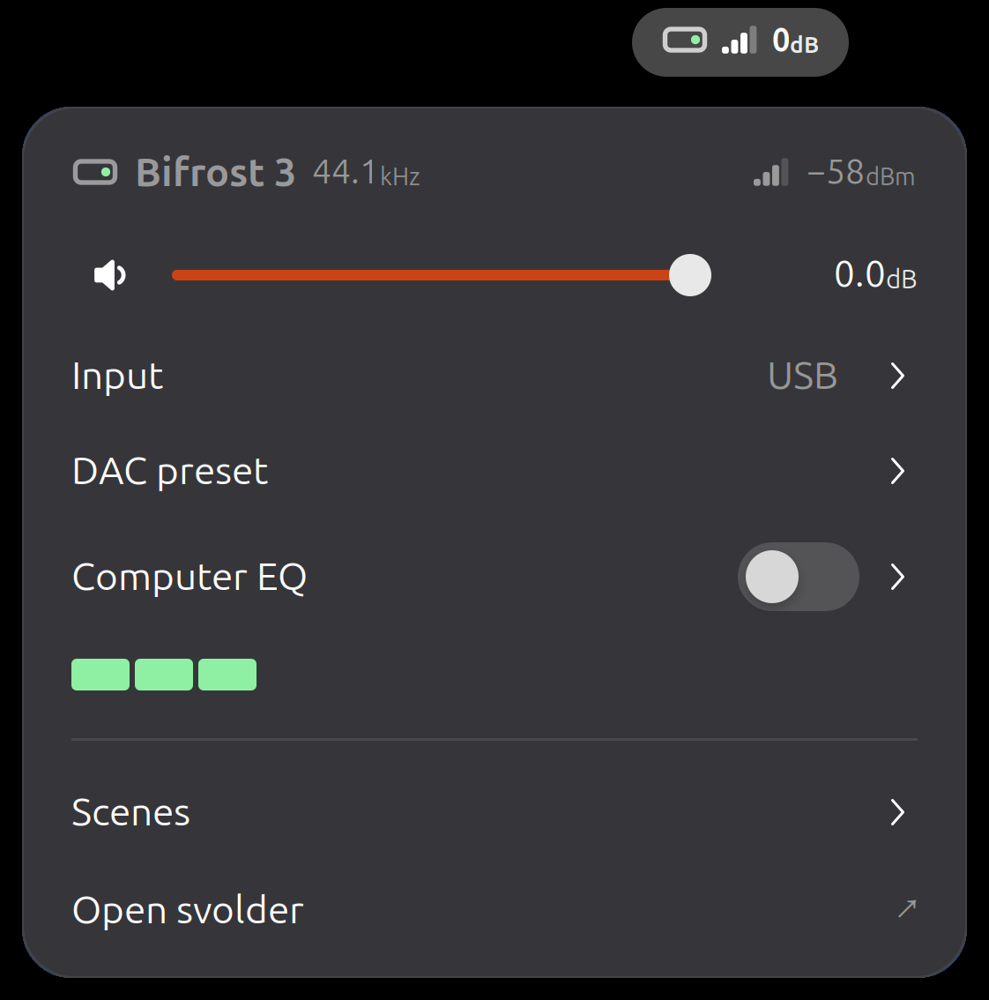
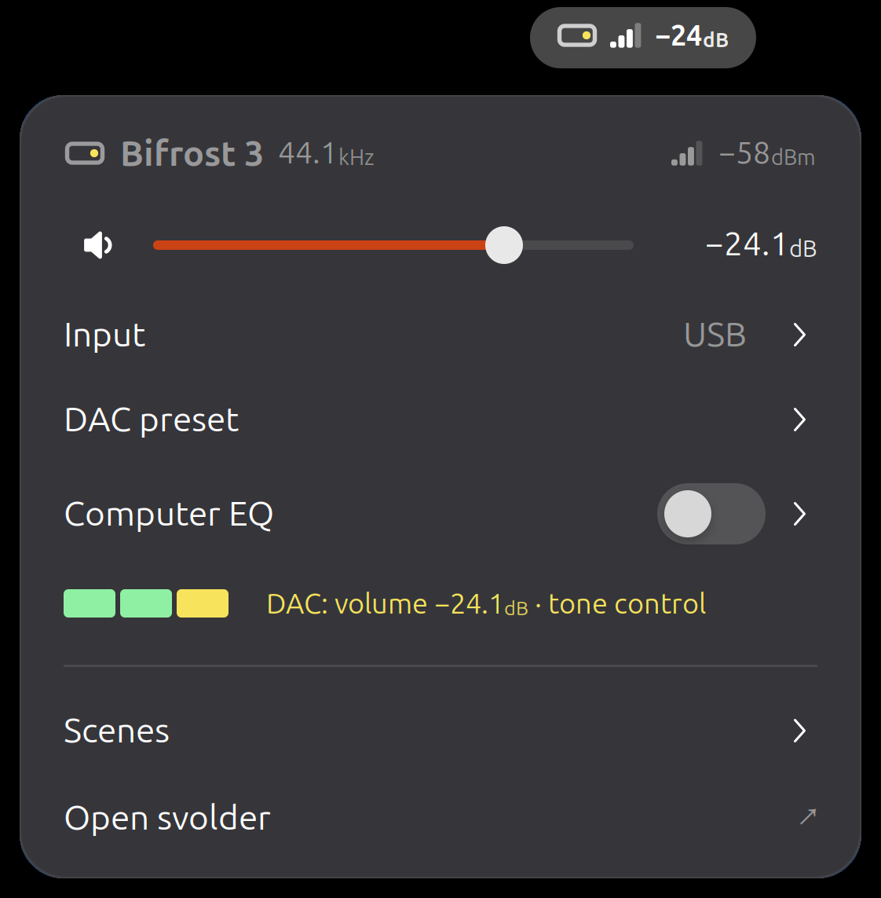

<!--
SPDX-FileCopyrightText: 2026 the svolder authors
SPDX-License-Identifier: GPL-3.0-or-later
-->

# The GNOME top-bar indicator

An extension for GNOME Shell 50 and 51 that puts your DAC in the top bar: the box with a light for
the sound's Path, the Bluetooth signal, and the volume. Click it for a popup with the controls you
reach for most. It is a thin front end: it reads one stream from `svolder panel --json` and runs
one `svolder` call per click, so everything it does the CLI, the TUI and the web page do too.

 

## What it needs

- GNOME Shell 50 or 51.
- A running `svolderd`. The indicator's own calls start none: the stream (`svolder panel`) only
  connects to the daemon's socket, and every click runs with the global `--no-start` (see
  [environment variables](environment.md), `SVOLDER_NO_START`) and `--transport daemon`, so none of
  them starts a daemon, a socket unit or a Bluetooth session. Two things can still start one, and
  both are yours: if `svolderd.socket` is installed (see
  [the daemon](daemon.md#daemon-and-config)), systemd starts the daemon when the stream connects to
  the socket; and Open svolder runs `svolder tui`, which follows the normal launcher chain.
- The `svolder` the shell can find. The extension runs inside GNOME Shell, so it uses the `PATH`
  the shell was started with: a `svolder` that only your terminal's `PATH` knows (such as one in
  `~/.cargo/bin`) is not found, and the popup says `svolder is not on PATH`. Put it in `/usr/bin`
  or another folder your login session has.

## Install

Three ways. None of them turns the extension on; GNOME keeps a new extension off until you enable
it.

1. **From a package.** The `.deb`, the `.rpm`, the Arch `PKGBUILD` and the binary tarball carry
   the extension. The packages put it in
   `/usr/share/gnome-shell/extensions/svolder-indicator@rralex.github.io/`; from the tarball, copy
   its `gnome-shell/svolder-indicator@rralex.github.io` folder there, or into
   `~/.local/share/gnome-shell/extensions/`. Then enable it in the Extensions app, or run:

        gnome-extensions enable svolder-indicator@rralex.github.io

2. **From source.** In a checkout, `make install-gnome-extension` packs the folder
   `contrib/gnome-shell/svolder-indicator@rralex.github.io` with `gnome-extensions pack` and
   installs the zip into `~/.local/share/gnome-shell/extensions/`. Enable it as above.
   `make uninstall-gnome-extension` removes it.

3. extensions.gnome.org: not yet.

A copy that `make install-gnome-extension` puts in `~/.local/share/gnome-shell/extensions/` takes
precedence over the package's copy in `/usr/share`; remove it with `make uninstall-gnome-extension`
to use the packaged one.

**A new extension shows up only after you log out and in again** (GNOME 50 and 51 run on Wayland).

## The bar

From left to right:

- **The DAC box.** An outline of a box with a light in its corner.
  - The light follows the colour of the Path row's label in the [TUI](tui.md) and on the web page
    (the `path.tone` of `svolder panel --json`): **green** when the sound is untouched from the
    player to the DAC, **yellow** when something changes it (the computer resamples or changes the
    volume, the DAC's own volume or tone control is not neutral, or the PipeWire config check
    fails). A **hollow grey ring** means the DAC is away, or that the Path has no verdict for this
    DAC (the sound goes to another output, the source is another input, or it could not be read).
  - The outline is tinted by the sample rate, so a change of rate shows without opening anything.
    The colours are in the table below. The light itself never takes a rate colour.
- **The signal.** Four bars of rising height, filled by strength (the rule is under "The signal").
  One yellow bar means a weak signal; dim bars mean the reading is old; no filled bar, in grey,
  means the DAC is away.
- **The volume.** The figure in dB with a small, lowered `dB` after it (`−24 dB`). When the DAC is
  muted a muted-speaker glyph replaces the figure (the figure is not struck through, and no second
  glyph is added): one cue on the figure. The light still follows the Path verdict, and a mute
  counts as a change to the sound, so the light turns yellow while the DAC is muted. When the DAC is
  away there is no figure.

Scrolling over the indicator changes the volume by the device's own step through the daemon's
volume rule; notches that arrive while a call runs are added to the next call. There is no Path
strip on the bar and no tooltip.

### The sample-rate tint

Eight rates, one colour each, saturation rising with the rate:

Any other rate (32 kHz, 22.05 kHz, an unknown one) is plain: no tint.

| Rate | Colour | Hex |
|---|---|---|
| 44.1 kHz | light grey | `#cfcfcf` |
| 48 kHz | white | `#ffffff` |
| 88.2 kHz | pale blue | `#b8d8ff` |
| 96 kHz | blue | `#86b4ff` |
| 176.4 kHz | violet | `#a58aff` |
| 192 kHz | magenta | `#d476f0` |
| 352.8 kHz | rose | `#f27aa8` |
| 384 kHz | coral | `#ff8c72` |

Green and yellow are left to the light, which is why no rate uses them.

## The popup

Click the indicator. From top to bottom:

1. **Header, one line**: the box, the device's name in bold, the sample rate (`44.1 kHz`, the unit
   small), and on the right the signal bars with the strength (`−58 dBm`, the unit small). The
   header's box is drawn plain; only the bar's box takes the rate tint.
2. **Volume**: a speaker button that mutes and unmutes, a slider, and the value (`−24.1 dB`) on its
   right. The value never wraps; the slider shrinks. The slider writes once, when you let go.
3. **Input**, with the current input; click for the list.
4. **DAC preset**: the same list the TUI's DAC preset row shows (tone presets on a device with a
   tone control, otherwise the preset slots and the built-in settings).
5. **Computer EQ**: a switch and the preset's name (see [Equaliser and presets](eq.md)); click the
   preset for the list. Hidden when the computer's controls are not available.
6. **Path**: three segments, player, computer and DAC, each green (untouched), yellow (it changes
   the sound) or grey (not read), and, only when something is off, the words for it in yellow
   (`DAC: volume −24.1 dB · tone control`). A failing PipeWire config check adds `config N`.
7. **Scenes** with the scene that is on at the right: a sub-menu to load another. 8. **Open
   svolder**: opens `svolder tui` (no flags) in a terminal emulator, so one has to be installed. It
   follows the normal launcher chain, so it may start the daemon or a Bluetooth session: you asked
   for it. It is always there; the web UI needs a port and a token.

When the DAC is away the popup keeps the header, Computer EQ and Scenes and hides the DAC's own
rows (volume, input, DAC preset and Path).

There is no now-playing, no transport and no graph; those stay in the TUI and on the web page.

Clicks are ignored while the stream is down (the popup then shows the failure line and no
controls). One click runs one `svolder` call; while a control's call is running a second one waits
its turn.

The extension never passes `--yes`. A call that needs a confirmation (it exits 1 and its message
names `--yes`) shows one line in the popup, `needs a confirmation: open svolder`; answer it in the
TUI. A call that exits 4, the device not confirming in time, shows the CLI's own line (or `the DAC
did not confirm in time`).

## The signal

The bars come from the one rule `svolder panel --json` applies (the extension does not re-judge):

| Strength | Bars |
|---|---|
| −55 dBm or stronger | 4 |
| −67 dBm or stronger | 3 |
| −80 dBm or stronger | 2 |
| weaker than −80 dBm | 1, yellow (weak) |

Bars go dim when the reading is older than two minutes, and the popup header then adds its age
(`−58 dBm · 3 min ago`).

While a Bluetooth LE link is up, BlueZ reports no signal strength. The figure is therefore the last
advertisement the computer heard before it connected, and the bars go dim two minutes after
connecting. That is how BlueZ works, not a fault of the device.

## Which device

`svolder panel` follows the CLI's rule: the device named with `-d`, else `default_device` from
[the config file](config.md), else the only device. The indicator passes no `-d`, so with several
devices set `default_device`. A DAC that is away, or no device at all, is not a failure: the bar
draws the away state, the popup keeps Computer EQ and Scenes, and the stream goes on. When the
stream began with no device and one appears, the indicator restarts it at once and quietly; any
other clean end restarts after the usual pause. The list of presets is read when the stream
starts, so a preset you save later shows after the next restart of the stream.

## When something is wrong

The popup shows one line and the bar draws the away state. Until the first line arrives the popup
says `waiting for svolder`. The extension tries the stream again after 1, 2, 4, 8, 16 and then
every 30 seconds, and starts the count again after a stream has run for a minute.

| Line | Meaning and next step |
|---|---|
| `svolder is not on PATH` | The command cannot be started from the shell's session. Install svolder where the session's `PATH` reaches (not only in `~/.cargo/bin`), then log out and in. |
| `the svolder daemon is not running` | No daemon answered; the line after it is the CLI's own next step. Start one (`svolder daemon install`, or `svolderd`); the indicator picks it up on its next try. |
| the CLI's first error line (exit 2) | Several devices are known and none is chosen: set `default_device` in the svolder config (see [the config file](config.md)). |
| `the svolder daemon is too old for this indicator` | Restart the daemon after updating svolder (`svolder daemon restart`). |
| `this svolder speaks another panel version` | The extension and the CLI come from different releases; update both. |
| `svolder panel stopped (exit N)` | Anything else; the line after it is the CLI's own message. |

## The design

How the model, the stream and the drawing fit together is in
[the design note](../design/gnome-indicator.md).
